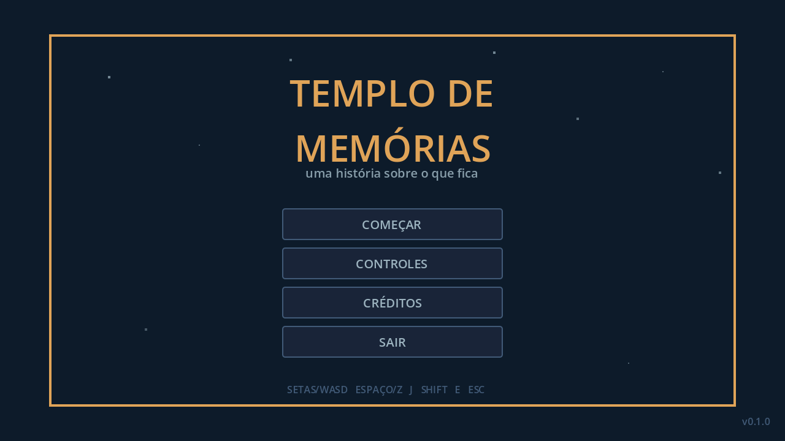
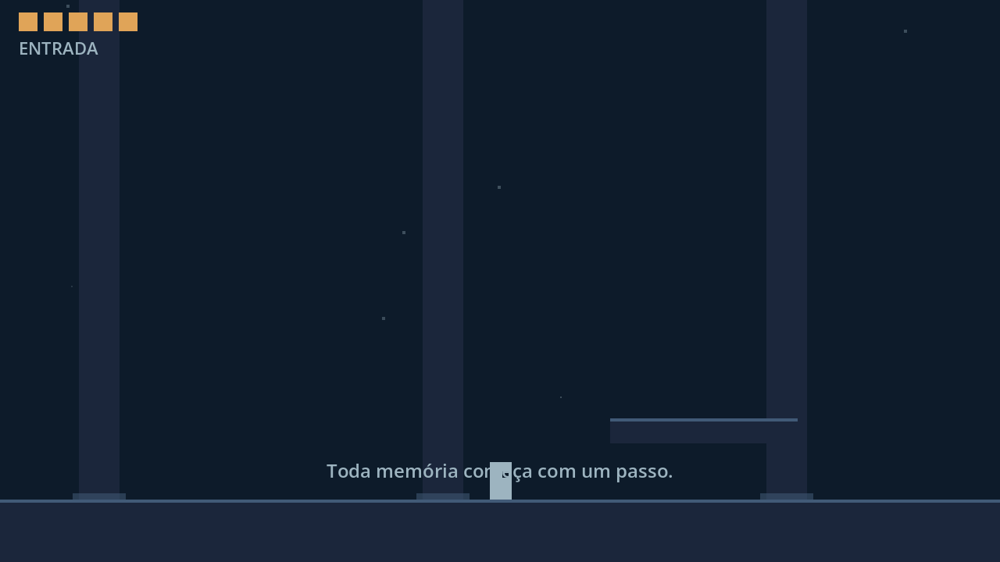
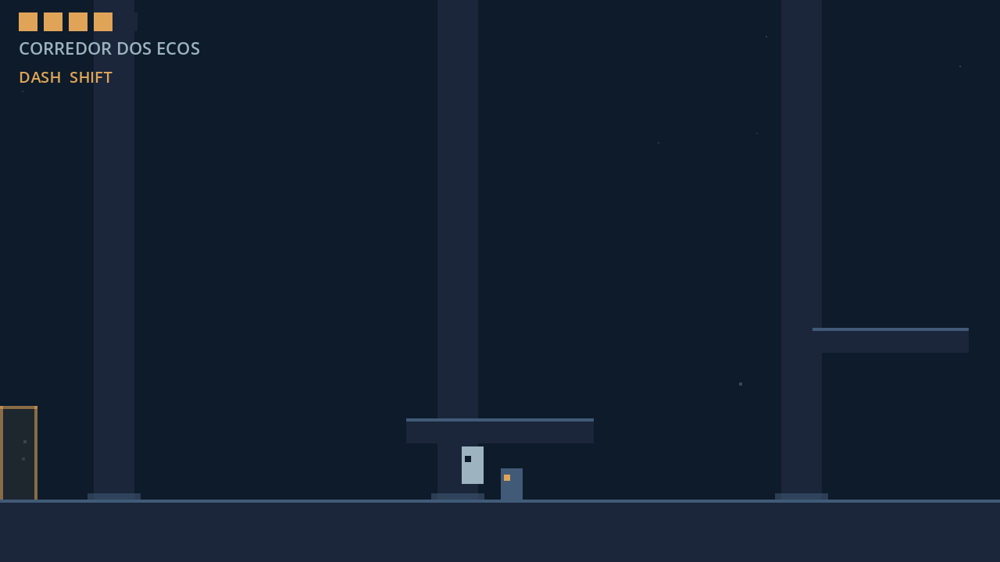
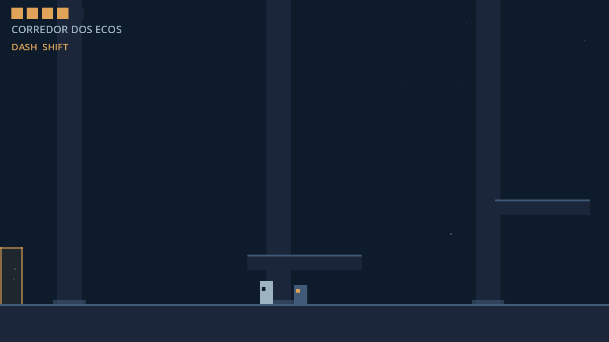
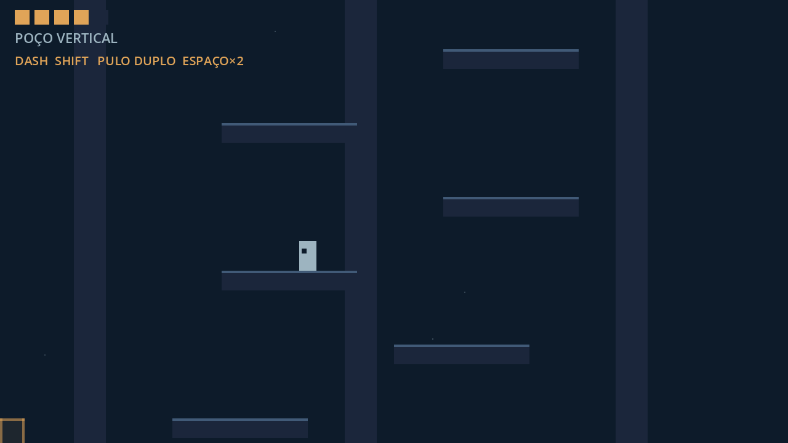
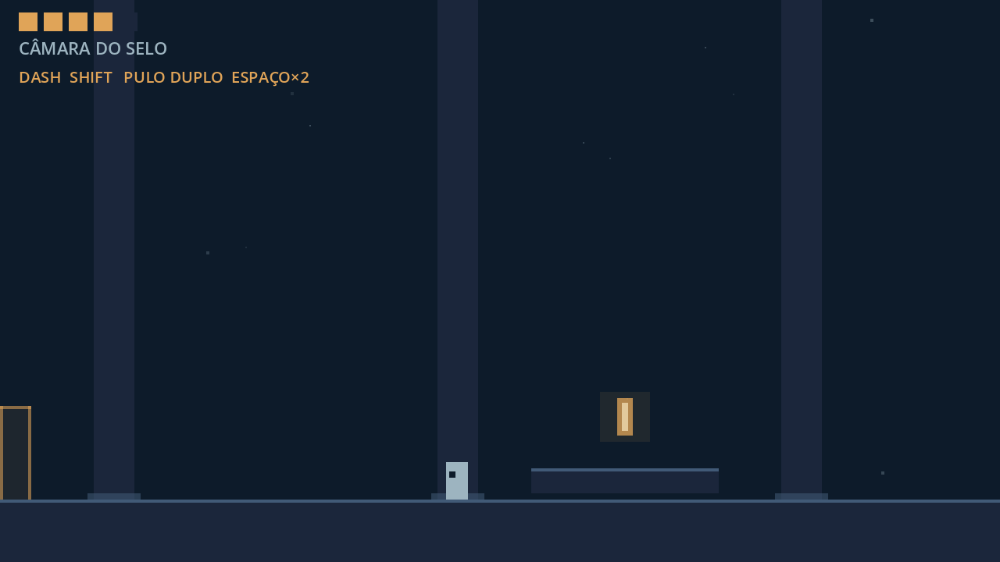
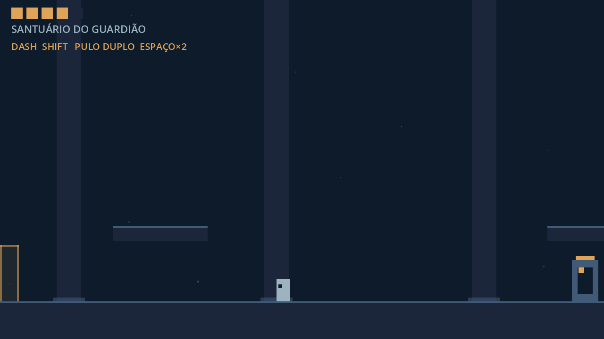
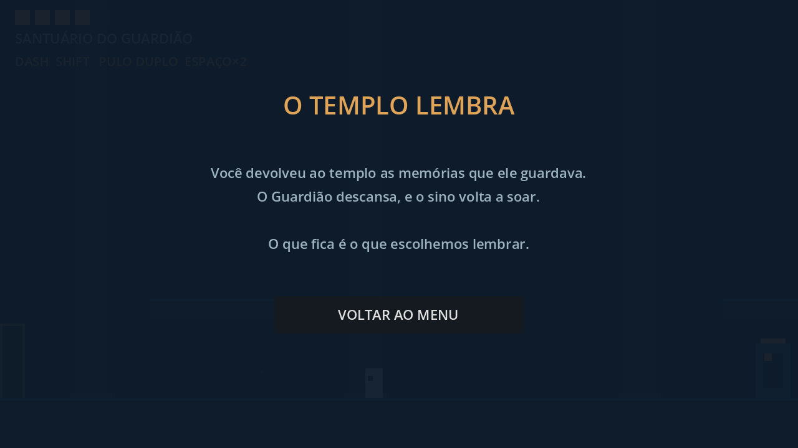

# Templo de Memórias

**▶ Jogar no navegador:** https://pimenteladryan-blip.github.io/jogo/

Mini-metroidvania 2D de ação-plataforma sobre memórias perdidas, feito em **Godot 4** (GDScript)
para projeto escolar.

Um espírito desperta num templo soterrado e descobre que cada sala guarda uma memória perdida.
Para avançar, ele recupera habilidades antigas e enfrenta o **Guardião** que sela a última lembrança.

## Status

**Todas as 9 etapas do plano concluídas.** Jogo completo, com 9 salas, 5 máscaras de vida,
dash, pulo duplo, 3 tipos de inimigo, chefe de duas fases e final.

O planejamento completo está em [`PLANO.md`](PLANO.md).

## Render (capturas do jogo rodando)

| Menu | Entrada |
|---|---|
|  |  |

| Corredor dos Ecos | Combate |
|---|---|
|  |  |

| Poço Vertical | Câmara do Selo |
|---|---|
|  |  |

| Guardião | Vitória |
|---|---|
|  |  |

As imagens foram geradas pelo próprio jogo em `1280×720` com o renderizador Compatibility.

## Controles

| Ação | Tecla |
|---|---|
| Mover | `←` `→` ou `A` `D` |
| Pular / pulo duplo | `Espaço` ou `Z` |
| Ataque | `J` ou clique esquerdo |
| Dash | `Shift` ou `K` |
| Interagir (intro) | `E` ou `Enter` |
| Pausar | `Esc` ou `P` |
| Reiniciar no sino | `R` |

## Como rodar

1. Abra o Godot 4.7+ e importe `project.godot`.
2. Pressione `F5` (o jogo abre no menu).

Pela linha de comando:

```bash
godot --path .
```

## O jogo

- **9 salas**: Entrada, Corredor dos Ecos, Sala do Sino, Poço Vertical, Jardim Interno,
  Câmara do Selo, Passagem Selada, Antessala do Guardião e Santuário do Guardião.
- **5 máscaras de vida**, dano com invencibilidade de 1 s e retorno pelo sino.
- **Habilidades**: ataque melee, dash (sala 6) e pulo duplo (sala 8).
- **Inimigos**: perseguidor, atirador com aviso de 0,5 s e o Guardião em duas fases.
- **Conteúdo livre**: inimigos se desfazem em partículas de luz, sem sangue.
- **Sem assets externos**: arte em formas e cores da paleta, sons sintetizados em GDScript.

## Etapas

| Etapa | Entrega |
|---|---|
| 0 | Projeto Godot 4, input map, renderer Compatibility 640×360 |
| 1 | Movimento, pulo com coyote time e câmera |
| 2 | Combate, inimigos, dano e HUD de vida |
| 3 | Salas data-driven, menu, intro, pausa, game over e sino |
| 4 | Dash e salas 4–7 com o vão da Passagem Selada |
| 5 | Pulo duplo, sala 8 e atalho para o Jardim |
| 6 | Chefe de duas fases, sala 9 e tela de vitória |
| 7 | Áudio sintetizado e atmosfera das salas |
| 8 | QA das 9 salas e capturas em `docs/renders` |

## Estrutura

```
project.godot
scenes/          # main.tscn, menu, player, inimigos, HUD, sino, item, projétil
scripts/         # lógica do jogo, salas, jogador, inimigos, áudio
docs/renders/    # capturas do jogo
planejamento/    # mockup do menu
```

## Créditos

Projeto escolar de Adryan Pimentel.
Feito com Godot 4, Git e GitHub.
